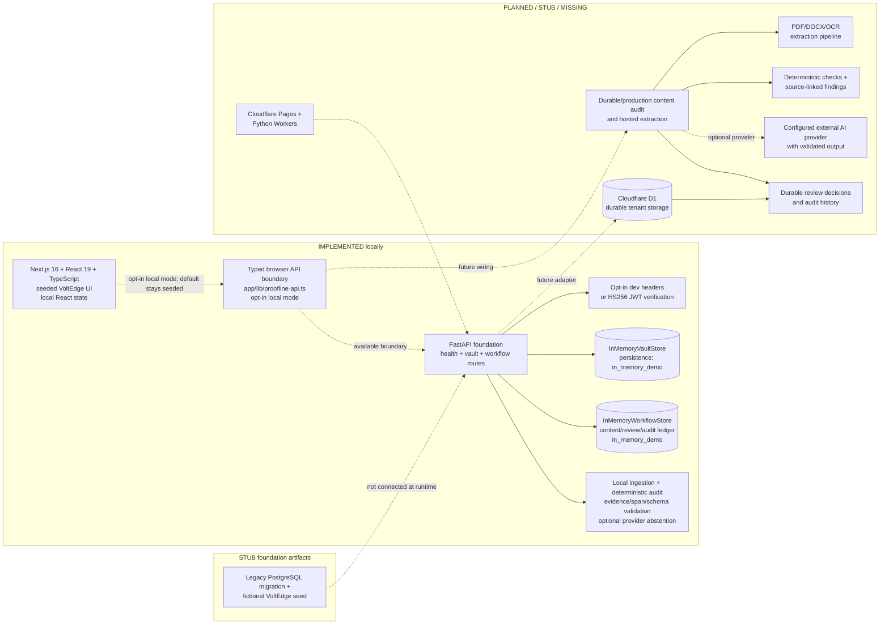

# Proofline architecture

**Document status:** Current repository architecture with explicit planned boundaries.
**Last reviewed:** October 26, 2026.
**Example tenant:** VoltEdge (fictional).

This document separates verified local behavior from the PRD's proposed production
architecture. A planned component is not available merely because a type, migration, or
route is documented.

## Status vocabulary

| Label | Meaning in this repository |
|---|---|
| **IMPLEMENTED** | Observed in the runnable repository or backed by a local testable path. |
| **STUB** | A foundation/scaffold exists, but the dependency or domain behavior is not connected or complete. |
| **PLANNED** | Described as a target in the PRD or contract; no current runtime proof is implied. |
| **MISSING** | Not present or not verified in the current workspace. |

## Current versus planned system

The dashed edges are boundaries or proposed integrations; they are not evidence that
the target component is active.

## Verified components

### Frontend — **IMPLEMENTED (local demo)**

- `app/` is the runnable Next.js application using React and TypeScript.
- `app/page.tsx` renders a seeded fictional VoltEdge workspace. Review findings,
  corrections, re-scan, comments, role preview, submission, approval, registry cards,
  insights, and synthetic audit events are local component state.
- The default screen displays demo-state cues and does not make a backend call; the
  content review routes have an explicit local development-header opt-in.
- The root `index.html`, `app.js`, and `styles.css` are retained prototype assets and are
  not the runnable product entry point.

### Typed API boundary — **IMPLEMENTED (opt-in local boundary)**

`app/lib/proofline-api.ts` defines typed vault/content/recheck/finding-action shapes and
request helpers for the local FastAPI routes. `/submit` and `/findings` invoke this client
only when the explicit local development-header mode is enabled; the default page remains
seeded browser state. Production authentication, durable persistence, and hosted content
audit remain unresolved.

### FastAPI foundation — **IMPLEMENTED (local)**

`backend/app/main.py` exposes:

- `GET /health`, which reports local process status, persistence mode, Cloudflare Access
  and local-JWT flags, binding status, and `ai_provider: "not_configured"`.
- Organisation-scoped vault routes for facts, terms, guidelines, disclaimers, and
  assets: list, create, get, create version, and approve.
- Role checks for registry writers, disclaimer writers, and `brand_owner` approval.
- Local content/review workflow routes for text/metadata versions, caller-supplied audit
  findings, finding actions, comments, review decisions, exports, and hash-linked events.
- `/contents` routes for bounded local ingestion, deterministic audit, claim/finding
  validation, and explicit provider/extraction failure states.

`backend/app/store.py` retains records in an `InMemoryVaultStore`. The process loses its
records on restart and is not a production storage layer. `backend/app/workflow.py`
provides review state; `backend/app/content_store.py` and `backend/app/audit/` add a local
content-audit path that ingests supported local inputs, runs deterministic checks, and
persists validated audit results in memory. The optional model seam abstains when no
provider is configured.

### Authentication boundary — **IMPLEMENTED (local boundary)**

The local service can resolve a principal from explicitly enabled development headers or
from a signed HS256 bearer token when `PROOFLINE_JWT_SECRET` is configured. This validates
the local authorization boundary; it does not provide Cloudflare Access verification,
D1 membership lookup, session management, refresh tokens, or production identity operations.

### Ingestion and deterministic verification — **IMPLEMENTED (local, dependency-gated)**

`backend/app/ingestion/` validates bounded text, PDF, DOCX, and image inputs and returns
explicit extraction states. Optional parser/OCR packages are imported lazily;
`backend/app/verification/` provides lexical claim extraction, source matching, and
deterministic rule helpers. These are local implementation paths, not evidence of a
hosted OCR or model service.

`backend/app/audit/engine.py` orchestrates ingestion output, deterministic checks,
optional model candidates, and local evidence/span/schema validation. The separate
`backend/app/reliability.py` engine is offline-only and reports bounded local checks;
it does not make network calls.

### SQL foundations — **STUB / PLANNED**

`cloudflare/migrations/` contains the target SQLite/D1 schema and `cloudflare/seed.sql`
contains fictional VoltEdge records. `supabase/` is retained as a legacy PostgreSQL/RLS
reference and is no longer the planned deployment target. No live D1 database, R2 bucket,
Queue, Access policy, or durable runtime adapter is verified.

### Cloudflare deployment boundary — **READY / NOT DEPLOYED**

- `next.config.ts` enables a static export when `CLOUDFLARE_PAGES_BUILD=1`; the Pages
  artifact is `out/` and does not require a Node server at runtime.
- `backend/worker.py` exposes the existing FastAPI application through Cloudflare's
  Python ASGI Worker adapter.
- `wrangler.jsonc` declares the intended Worker, D1, R2, and Queue bindings. Placeholder
  IDs are deliberate and must be replaced in private deployment configuration.
- The current stores remain in-memory. Binding declarations do not prove that D1/R2/Queue
  persistence or background consumers are implemented.

## Actual versus planned technical decisions

| Decision area | Actual repository choice | Planned or unresolved choice | Why the boundary exists |
|---|---|---|---|
| Frontend framework | Next.js 16 + React 19 + TypeScript | The PRD's alternative Vite/Tailwind/shadcn direction remains **PLANNED** unless a later migration is verified. | Preserve the runnable application and avoid a parallel frontend. |
| UI data source | Seeded local React state by default; opt-in local API for `/submit` and `/findings` | Wire the typed client to a durable API after production authentication and persistence exist. | The default screen is a demonstration; the opt-in path is local/in-memory and not production auth. |
| API runtime | FastAPI with local health, vault, content-audit, impact, and review routes | Add durable adapters and verify external provider execution behind the contract. | Keep a small server-side boundary while persistence and hosted services remain incomplete. |
| Vault persistence | `InMemoryVaultStore` (**IMPLEMENTED locally**) | Cloudflare D1 adapter with tenant isolation and durable history (**PLANNED**). | Avoid presenting ephemeral state as production data. |
| Authentication | Opt-in dev headers and optional local JWT verifier (**IMPLEMENTED locally**) | Cloudflare Access JWT verification plus D1 membership/session mapping (**PLANNED**). | A client-supplied organisation ID is never sufficient authorization. |
| Content extraction | Bounded local text/PDF/DOCX/image ingestion with explicit extraction states (**IMPLEMENTED locally, dependency-gated**) | Hosted parser/OCR service and production file storage (**PLANNED / MISSING**) | Empty or partial extraction must never look like a successful audit. |
| Finding generation | Local lexical claims, deterministic rules, and audit-engine validation (**IMPLEMENTED locally**) | Broader production rule coverage and durable generated findings (**PLANNED**) | Findings need applicable source/version links and validation; missing evidence remains review-required. |
| AI provider | Gemini adapter exists but is unconfigured/offline unless env values and SDK are present (**STUB**) | Verified external provider/model, redaction, schema validation, bounded retry, and disclosure (**PLANNED**) | Model output is a candidate, not proof. |
| Audit/review persistence | UI transitions plus local in-memory content versions, findings, comments, review decisions, exports, and hash-linked events (**IMPLEMENTED locally**) | Durable immutable content versions, audits, findings, and review decisions (**PLANNED**). | Preserve traceability and human accountability beyond one process. |
| Deployment | Local scripts, Dockerfiles, Pages export, and Python Worker entrypoint exist (**READY / NOT DEPLOYED**) | Cloudflare Pages/Workers with D1, R2, Queues, Access, and smoke checks (**PLANNED**). | A config or Worker entrypoint is not a deployment. |

## Data and trust boundaries

1. The browser demo contains synthetic seeded state and should not receive confidential
   customer material.
2. The local API receives authenticated test requests only when local auth is explicitly
   enabled; records remain in process memory. The target Worker must resolve identity and
   membership at the edge/API boundary before querying D1.
3. Future external AI/OCR calls must be server-side, minimum-context, and disclosed before
   transfer. Confidential-tagged content must bypass external model calls as required by
   the contract.
4. Findings must remain tied to the content version and source/rule version used. Missing
   evidence is a review state, not a contradiction.

## Architecture references

- [`docs/CONTRACT.md`](CONTRACT.md) — typed finding shape and endpoint status
- [`docs/AI_DISCLOSURE.md`](AI_DISCLOSURE.md) — provider and data-processing disclosure
- [`docs/PRIVACY_SECURITY.md`](PRIVACY_SECURITY.md) — local security and privacy boundary
- [`Proofline_Consolidated_PRD.md`](../Proofline_Consolidated_PRD.md) — proposed product architecture
